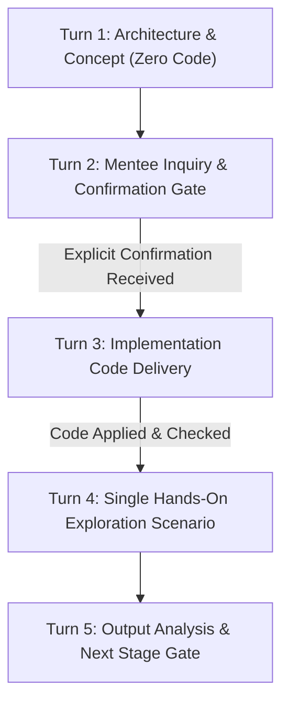

# Legacy Docs & Curriculum Governance Skill

## 1. Overview & Core Philosophy

This skill is the repo-mechanics companion to **`skills/mentor-governance/SKILL.md`** (the canonical operating rulebook — read that first for the Asl-ha, the 8-Gate Firewall, and standing scope agreements; this file does not repeat them). What lives here is specific to *how this repository is built and taught* rather than *how the mentor should behave*: the 5-Turn pedagogical delivery model, import/architecture mechanics unique to this codebase, and an anti-pattern checklist distilled from real mistakes made and corrected in `docs/MENTOR_HANDOFF.md`.

### Core Engineering Principles
1. **Production-Grade System Design over Superficial Tutorials:**
   Every component is engineered with real failure boundaries, type safety, modular decoupling, and robust error recovery—not one-off unconstrained notebook scripts.
2. **Progressive Complexity Arc (Phase A → B → C):**
   - **Phase A (Baseline):** Minimal, fully functioning core agent solving the fundamental problem.
   - **Phase B (Enterprise Growth):** Structured outputs, human-in-the-loop (HITL), checkpoint persistence, self-correction loops, and streaming.
   - **Phase C (Professional & Composition):** Modular subgraphs, `CompiledSubAgent` wrappers, multi-agent composition, time-travel debugging, and observability.
3. **Framework Pragmatism:**
   - **LangChain:** Model abstractions, tool definitions, prompt templates, structured output parsing, middleware, and guardrails.
   - **LangGraph:** Deterministic state graphs, cyclic loops, conditional routing, state checkpointing, human approval gates (`interrupt()`), and state history inspection.
   - **DeepAgents:** Autonomous planning, dynamic delegation, sandboxed execution (`LocalShellBackend`), workspace confinement, memory/skills, and inter-agent coordination.
4. **Capstone Destinations (P6 and P12):**
   Each project's Phase C produces a reusable `CompiledSubAgent` that plugs directly into the P6 and, later, P12 capstone coordinators. See `docs/Agentic AI Curriculum Roadmap v2.md` for the full 12-project shape and the mini-workflow cadence — that document is canonical for curriculum structure, not the table that used to live in this section.

---

## 2. The 5-Turn Pedagogical Interaction Model

Every stage within a phase follows a strict, sequential 5-turn interaction protocol:

1. **Turn 1 — Architecture & Conceptual Alignment (Zero Code):**
   - Deep, precise architectural explanation covering system design, component responsibilities, framework API shapes, and trade-offs.
   - **Infrastructure/Boilerplate Rule:** OS-level/infrastructure utilities (e.g. `subprocess`, `tempfile`, path resolvers) are explicitly flagged upfront as an *"Infrastructure / Boilerplate Pattern"* with a 2–3 line conceptual summary as a black box. Do not allow non-agentic stdlib syntax to distract from agentic architecture.
   - **Constraint:** Zero implementation code or test scripts in this turn.
2. **Turn 2 — Mentee Inquiry / Concept Confirmation:**
   - Answer all architectural/technical questions. Wait for explicit mentee confirmation (`"are"`, `"ok"`, `"edame bedim"`) before proceeding.
3. **Turn 3 — Implementation Source Code Delivery:**
   - Mentor writes and applies production-grade source code directly into `src/` files in the repository (the mentee works and explores in notebooks, e.g. `alireza/notebooks/`).
   - Deliver the applied code as a clear code block in the chat response.
   - **Pre-Verification Requirement:** The mentor MUST run `ruff` and `uv run pytest` to guarantee clean syntax, formatting, and zero regressions before sending (Ghanoon-e Pishmarg — see `skills/mentor-governance/SKILL.md`).
   - **Notes Boundary:** Any text following the code block discusses Python syntax/stdlib mechanics only (e.g., sentinel patterns, Windows path quirks). Architectural reasoning belongs solely in Turn 1.
   - **Constraint:** Implementation code only. No test cases or exploration scripts.
4. **Turn 4 — Hands-On Exploration Scenario Delivery:**
   - Delivered ONLY after the mentee confirms the code has been applied.
   - **Single-Item Rule:** Deliver strictly ONE test scenario or one task at a time. Never bundle multiple test cases.
5. **Turn 5 — Exploration Verification & Transition Gate:**
   - Mentee runs the scenario and shares terminal output. Mentor analyzes the run, highlights observed agent behaviors, validates success, and gates transition to the next stage.

---

## 3. Package Layout, Critical Rules & Import Mechanics

The canonical package-layout diagram lives in `AGENTS.md` (`## Package Layout`) — read that for the current `src/` tree, not a copy here. What follows is repo-specific mechanics not covered there:

- **Editable Install Discovery:** `pyproject.toml` registers `where = ["src", "alireza"]`. Whenever a new top-level package directory is created under `src/`, run `uv sync --reinstall-package agent` to refresh editable install metadata.
- **Absolute Path Anchoring:** Never use relative paths like `root_dir="."`. Always anchor to `REPO_ROOT` using `Path(__file__).resolve().parents[N]`.
- **Output Extraction with `get_text()`:** Always route `AIMessage.content` through `get_text(message)` (`src/utils/get_text_util.py`) to safely handle both plain strings and Gemini-style list-of-content-blocks.
- **Mutable Default Arguments:** Always use sentinel `None` in agent factories (`checkpointer = checkpointer or InMemorySaver()`, `backend = backend or LocalShellBackend(...)`).
- **No Direct Inspection of Private Attributes:** Never inspect brittle Pregel internals like `agent.nodes['tools'].bound.tools_by_name`. Inspect public structures (`agent.get_graph().nodes`) or execute black-box invokes.
- **Windows Environment:** Always pass `inherit_env=True` to `LocalShellBackend` on Windows to preserve system `PATH`.
- **Isolation of `alireza/`:** The `alireza/` directory is the mentee's independent practice area. Core code never imports from `alireza/`.

---

## 4. Anti-Patterns & Red Flags Checklist

| Anti-Pattern / Mistake | Required Correction |
| :--- | :--- |
| Writing formal unit tests in `tests/` during regular stages | **STOP.** Formal test suites are deferred to Term E. Deliver runnable apps in `src/apps/` and interactive exploration scenarios. |
| Guessing API signatures or parameters | **STOP.** Query `docs-langchain` MCP and `context7`, or inspect `.venv/Lib/site-packages/`. |
| Sending code and explanation in the same turn | **STOP.** Turn 1 is explanation only (zero code). Code is sent in Turn 3 only after explicit confirmation. |
| Bundling multiple test scenarios in one turn | **STOP.** Turn 4 delivers strictly ONE hands-on test scenario at a time. |
| Overwriting or editing mentee files directly | **STOP.** Deliver code blocks in chat. The mentee applies code manually. |
| Using mutable default arguments in factory functions | Use sentinel `None` and initialize inside the function body. |
| Inspecting `agent.nodes['tools'].bound.tools_by_name` | Inspect `agent.get_graph().nodes` or test via `.invoke()`. |
| Omitting `inherit_env=True` on Windows `LocalShellBackend` | Always set `inherit_env=True` so `python` in `PATH` is preserved. |
| Using relative path roots (`root_dir="."`) | Anchor absolutely: `Path(__file__).resolve().parents[N]`. |
| Introducing unexplained parameters or sneak-in arguments | **STOP.** Every single parameter, default, and framework mechanism must be explicitly disclosed and pedagogically explained before appearing in code. |
| Restating or hand-editing a copy of the operating-principles rulebook in this file, `AGENTS.md`, or elsewhere | **STOP.** Edit `skills/mentor-governance/SKILL.md` only; everything else points to it. |
