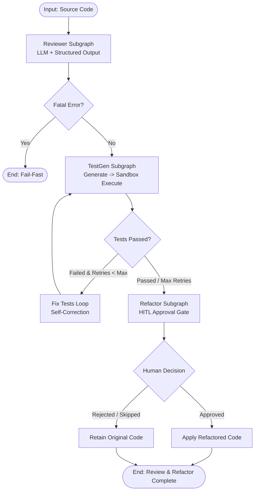

# P3: Code Review & Test Generation Agent — Comprehensive Master Guide

---

## 1. Executive Summary & Architectural Vision

The **P3 Code Review & Test Generation Agent** is a production-grade, stateful autonomous system designed to ingest raw source code or PR diffs, produce structured code quality audits, generate regression test suites, safely execute tests in isolated sandboxes, self-correct failing test code, request human approval for critical refactors, and maintain durable state history with time-travel capabilities.



---

## 2. Phase A: Baseline Architecture (Foundational State & Structured Output)

### 2.1 State Design: `CodeReviewState`
Located at `core/src/state/code_review.py`.
In LangGraph, state acts as the single source of truth across all nodes and subgraphs.

```python
from typing import TypedDict
from output_schemas.code_review import ReviewResult, TestExecutionResult, TestSuite

class CodeReviewState(TypedDict, total=False):
    code: str
    language: str
    file_path: str | None
    review: ReviewResult | None
    tests: TestSuite | None
    test_execution: TestExecutionResult | None
    test_retries: int
    refactor_decision: str | None
    error: str | None
```

**Key Architectural Insights:**
- `total=False`: Enables partial-state updates. Each node returns only the keys it modifies without overwriting the entire state dictionary.
- **Fail-Fast Error Channel (`error`):** If an LLM call or external API fails, the node populates `error`. Downstream conditional edges inspect this key immediately to abort execution and prevent costly subsequent steps.

### 2.2 Strict Structured Output Schemas
Located at `core/src/output_schemas/code_review.py`.
Using Pydantic V2 models ensures 100% type safety and reliable machine consumption.

- `ReviewResult`: Contains numerical score (1-10), qualitative summary, list of `CodeIssue` (line number, severity, category, description, suggestion), and optional `refactored_code`.
- `TestSuite`: Contains test framework name, list of `TestCase`, and the raw runnable `test_code`.
- `TestExecutionResult`: Encapsulates sandbox status (`passed`, `failed`, `timed_out`, `error`), exit code, boolean `passed`, and execution stdout/stderr.

---

## 3. Phase B: Growth Architecture (Execution, Loops & Persistence)

### 3.1 Sandbox Runner & Process Isolation
Located at `core/src/utils/sandbox.py`.
LLM-generated tests must **never** be executed directly in the host agent's runtime process.

```python
def run_tests_in_sandbox(
    code: str,
    test_code: str,
    sandbox_type: SandboxType = "local",
    timeout_seconds: int = 30,
) -> TestExecutionResult:
    # 1. Creates an isolated temporary directory
    # 2. Writes code as tested_module.py and test_code as test_module.py
    # 3. Spawns an isolated subprocess running pytest
    # 4. Enforces strict timeouts and captures full traceback
```

### 3.2 Cyclic Self-Correction Feedback Loop
Located at `core/src/nodes/code_review.py` & `core/src/graphs/test_gen_subgraph.py`.
When tests fail during sandbox execution:
1. `execute_tests_node` records the failure traceback into state.
2. `route_after_execution` checks `state["test_execution"].passed` and `test_retries < MAX_TEST_RETRIES`.
3. If failing, execution routes to `fix_tests_node`, which injects the traceback into `TEST_FIX_PROMPT`.
4. The LLM produces a corrected test suite and increments `test_retries`.
5. Execution loops back to `execute_tests_node` until tests pass or the retry budget is exhausted.

### 3.3 Human-in-the-Loop (HITL) Gate via `interrupt()`
Located at `core/src/graphs/refactor_subgraph.py`.
Modern LangGraph uses `interrupt(payload)` to pause the state machine:

```python
def approved_refactor_node(state: CodeReviewState) -> dict:
    review = state.get("review")
    if not review or not review.refactored_code:
        return {"refactor_decision": "skip"}

    # Freeze execution and wait for human decision:
    human_response = interrupt(
        {
            "action": "refactor_approval_required",
            "proposed_code": review.refactored_code,
            "issues_addressed": len(review.issues),
        }
    )
    return {"refactor_decision": human_response.get("decision", "rejected")}
```
The caller resumes execution seamlessly using `graph.invoke(Command(resume={"decision": "approved"}), config=config)`.

### 3.4 Persistent SQLite Checkpointing
Located at `core/src/data/sqlite_db.py`.
`SqliteSaver.from_conn_string("core/src/data/checkpoints.db")` serializes graph state at every super-step.
- Enables persistent cross-session recovery.
- Allows thread-isolated execution via `{"configurable": {"thread_id": "session_id"}}`.

---

## 4. Phase C: Professional Architecture (Modular Subgraphs & DeepAgents Integration)

### 4.1 Modular 3-Subgraph Architecture
Instead of a single monolithic StateGraph, P3 decomposes responsibilities into 3 independent, compiled subgraphs:
1. **`ReviewerSubgraph`** (`core/src/graphs/reviewer_subgraph.py`): Standalone code analysis and review generation.
2. **`TestGenSubgraph`** (`core/src/graphs/test_gen_subgraph.py`): Standalone test generation, sandbox execution, and retry loop.
3. **`RefactorSubgraph`** (`core/src/graphs/refactor_subgraph.py`): Standalone HITL approval gate and code modification.

**Parent Graph Orchestration:**
`core/src/graphs/code_review_parentgraph.py` mounts these compiled subgraphs as nodes:
```python
workflow.add_node("reviewer", build_reviewer_subgraph())
workflow.add_node("test_generator", build_test_gen_subgraph())
workflow.add_node("refactor_gate", build_refactor_subgraph())
```

### 4.2 DeepAgents `CompiledSubAgent` Adapter
Located at `core/src/subagents/code_review.py`.
DeepAgents communicates via `messages: list[BaseMessage]`. To expose our deterministic Parent Graph to DeepAgents supervisors, we implement the **Adapter Pattern** via `RunnableLambda`:

```python
code_review_subagent = {
    "name": "code_review_subagent",
    "description": "Reviews code, generates/runs unit tests, and proposes refactors.",
    "runnable": RunnableLambda(_run_code_review_from_messages),
}
```

### 4.3 Time-Travel & State History Exploration
Located at `core/src/utils/time_travel.py`.
Because every state snapshot is persisted in SQLite:
- `inspect_state_history(graph, thread_id)`: Fetches chronological execution milestones.
- `fork_from_checkpoint(graph, thread_id, checkpoint_id)`: Rewinds time to a specific historical checkpoint and forks execution down an alternative path.

---

## 5. Signature Code Catalog (P3 Architecture Showcase)

| Component | File Path | Architectural Role |
|---|---|---|
| **State Schema** | `core/src/state/code_review.py` | Typed partial-state contract |
| **Output Schemas** | `core/src/output_schemas/code_review.py` | Pydantic V2 structured models |
| **Sandbox Execution** | `core/src/utils/sandbox.py` | Isolated subprocess test execution |
| **Reviewer Subgraph** | `core/src/graphs/reviewer_subgraph.py` | Standalone review node |
| **TestGen Subgraph** | `core/src/graphs/test_gen_subgraph.py` | Cyclic self-correcting test generator |
| **Refactor Subgraph** | `core/src/graphs/refactor_subgraph.py` | HITL pause/resume gate |
| **Parent Pipeline** | `core/src/graphs/code_review_parentgraph.py` | 3-subgraph deterministic orchestrator |
| **SubAgent Adapter** | `core/src/subagents/code_review.py` | DeepAgents integration wrapper |
| **Time-Travel Utils** | `core/src/utils/time_travel.py` | State inspection & history replay |
| **Database Checkpointer** | `core/src/data/sqlite_db.py` | SQLite connection manager |

---

## 6. Production Verification & Test Coverage

- **Linter & Formatter:** 100% clean (`uv run ruff check core/ tests/` -> 0 errors).
- **Automated Test Suite:** 12/12 unit tests passing in `tests/test_code_review.py` & `tests/test_prompts.py`:
  - `test_schemas_instantiation`: Verifies Pydantic contracts.
  - `test_route_after_reviewer_and_test_gen`: Validates conditional edges and fail-fast routing.
  - `test_sandbox_execution_passed`: Verifies sandbox runner on valid code.
  - `test_sandbox_execution_failed`: Verifies sandbox runner on syntax/assertion failures.
  - `test_standalone_subgraphs_compile`: Confirms isolated subgraph compilation.
  - `test_subagent_spec_structure`: Validates DeepAgents adapter dictionary.
  - `test_time_travel_utilities`: Verifies checkpoint history inspection and time rewind.
