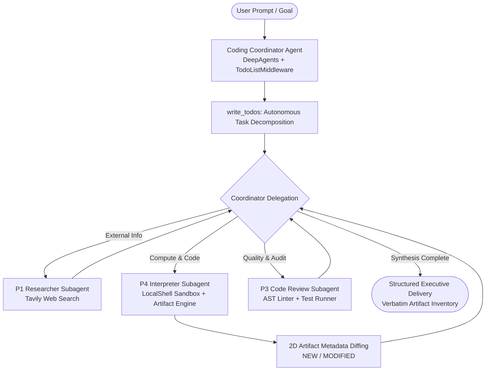

# P4: Sandbox / Interpreter Agent & Multi-Agent Coding Coordinator — Master Study Guide

---

## 1. Executive Summary & Architectural Vision

The **P4 Sandbox / Interpreter Agent & Multi-Agent Coding Coordinator** marks the transition from purely conversational, text-bound AI agents to **environment-grounded, stateful execution systems**. Rather than merely generating code snippets in chat, P4 equips agents with a governed, isolated execution runtime (sandbox), physical workspace management, file artifact tracking, risk-sensitive human approval gates, and autonomous multi-agent supervisory coordination.



### Core Evolution in Curriculum:
- **P1 (Research):** Taught tool use, citations, and structured reporting.
- **P2 (RAG):** Taught deterministic graph state, corrective retrieval, and vector memory.
- **P3 (Code Review):** Taught subgraphs, AST linting, isolated test execution, and human approval.
- **P4 (Interpreter & Coordinator):** Unifies P1, P3, and P4 execution into a **hierarchical multi-agent control tower** with autonomous planning, filesystem side effects, artifact provenance, and universal streaming observability.

---

## 2. Phase A: Baseline Architecture (Native LocalShell Execution)

### 2.1 The Execution Sandbox: `LocalShellBackend` / `SandboxBackend`
Located at `src/utils/sandbox_util.py`.

A fundamental rule of production agent engineering: **LLM-generated code must NEVER execute directly in the host agent's native environment.**

P4 establishes a dedicated, bounded workspace (`out/sandbox/`) wrapped by `LocalShellBackend`:
```python
from deepagents.backends import LocalShellBackend
from utils.sandbox_util import SandboxBackend

backend = SandboxBackend(
    root_dir=DEFAULT_SANDBOX_DIR,      # out/sandbox/
    virtual_mode=DEFAULT_VIRTUAL_MODE,  # Enforces boundary containment
    inherit_env=DEFAULT_INHERIT_ENV,    # Filters dangerous host environment variables
    timeout=DEFAULT_EXECUTE_TIMEOUT,    # Prevents runaway infinite loops (e.g. 60s)
    max_output_bytes=DEFAULT_MAX_OUTPUT_BYTES, # Truncates output to protect LLM context
)
```

### 2.2 Built-in File & Shell Toolset
Through `create_deep_agent`, the Interpreter agent is equipped with five standardized tools:
1. `execute(command)`: Runs shell commands within `root_dir`.
2. `view_file(path)`: Reads text or code files with strict offset/limit controls.
3. `write_file(path, content)`: Creates or overwrites files.
4. `edit_file(path, target, replacement)`: Performs atomic string replacements.
5. `list_directory(path)`: Explores directory trees.

---

## 3. Phase B: Growth Architecture (Governance, Artifacts & Checkpointing)

### 3.1 Risk Governance & Human-in-the-Loop (HITL)
Located at `src/agents/interpreter_agent.py` and `src/utils/run_with_hitl_util.py`.

Command execution has permanent side effects (deleting files, creating infinite processes, network calls). P4 introduces a strict permission policy using LangGraph interrupts:
```python
interrupt_on = {"execute": True}  # Interrupt before executing any shell command
```
When `execute` is invoked:
1. The agent graph pauses execution via `__interrupt__`.
2. `run_with_hitl` intercepts the interrupt, displays the requested command to the human operator, and prompts:
   `Approve execute action? [y/n]: `
3. If approved (`y`), execution resumes. If rejected (`n`), the operator enters an optional rejection reason, which is routed back to the LLM for self-correction.

### 3.2 Artifact Lifecycle & Directory Segregation
Located at `src/configs/interpreter_config.py`.

To avoid cluttering the workspace with temporary runner scripts, P4 strictly separates runner scripts from final deliverables:
- **Runner / Scratch Scripts:** `out/sandbox/calc.py`, `out/sandbox/generate.py`.
- **Client Deliverables:** `out/sandbox/artifacts/` (`*.csv`, `*.svg`, `*.md`, `*.png`).

The prompt instructs the agent:
> *"Always save generated data, reports, charts, and final output files into the `artifacts/` subfolder. Do NOT leave deliverable output files in the root workspace."*

### 3.3 Universal Session Resolution & Thread Management
Located at `src/utils/session_util.py`.

Stateful agents require robust CLI session lifecycle management. `resolve_session` provides seven standardized modes:
1. `default`: Uses global persistent SQLite thread (`DEFAULT_THREAD_ID`).
2. `new`: Generates a unique UUID thread (`app_a1b2c3`) persisted to SQLite.
3. `secret`: Ephemeral in-memory session (`InMemorySaver`) that is **never** written to disk.
4. `list` / `history`: Prints reverse-chronological list of previous sessions.
5. `resume`: Automatically reconnects to the most recent active thread.
6. `step[N]`: Reconnects to the N-th most recent recorded session.
7. `custom_name`: Resumes or starts a named thread.

---

## 4. Phase C: Professional Architecture (Packaging, Coordination, Registry & Observability)

### 4.1 Packaging as `CompiledSubAgent` with 2D Artifact Diffing
Located at `src/subagents/interpreter_subagent.py`.

To make the stateful Interpreter agent delegable to high-level coordinators without layer inversion or circular imports, P4 packages it via **Pure Dependency Injection**:
```python
def make_interpreter_subagent(
    agent: Any,
    name: str = "code_interpreter",
    description: str = DEFAULT_SUBAGENT_DESCRIPTION,
    sandbox_dir: Path | None = None,
) -> CompiledSubAgent:
```

#### Two-Dimensional (2D) Artifact Diffing:
The subagent closure inspects `artifacts/` before and after each execution turn:
```python
# 1. Baseline capture: record path, size, and mtime
pre_artifacts = {a.path: a for a in list_sandbox_artifacts(target_dir)}

# 2. Invoke the underlying agent runnable
result = agent.invoke({"messages": incoming_messages}, config=turn_config)

# 3. Post-turn capture: compare against baseline
post_artifacts = {a.path: a for a in list_sandbox_artifacts(target_dir)}
new_files = [a for p, a in post_artifacts.items() if p not in pre_artifacts]
modified_files = [
    a for p, a in post_artifacts.items()
    if p in pre_artifacts and (a.size_bytes != pre_artifacts[p].size_bytes or a.modified_at != pre_artifacts[p].modified_at)
]
```
The subagent automatically appends a structured deliverable summary to the coordinator's incoming message:
```text
### Deliverables Update:
- [NEW] artifacts/cloud_pricing_comparison.csv (1.0 KB)
- [NEW] artifacts/cost_performance_tradeoffs.svg (5.8 KB)
```

### 4.2 Multi-Agent Coding Coordinator & Autonomous Planning
Located at `src/agents/coding_coordinator_agent.py` and `src/prompts/agents_prompt.py`.

The `coding_coordinator_agent` orchestrates three specialized subagents:
1. `code_interpreter`: Script execution and deliverable file generation.
2. `code_review`: AST linting, test coverage, and code quality audits.
3. `researcher`: External live web search and market intelligence.

#### Dynamic Planning via `TodoListMiddleware`:
```python
middleware = [
    retry_on_failure(tier),
    TodoListMiddleware(),  # Injects write_todos tool
]
```
The Coordinator autonomously plans multi-step pipelines:
1. `write_todos`: Decomposes user goal into 3-5 distinct pending items.
2. Marks the active item `in_progress`.
3. Dispatches delegation to `researcher` -> `code_interpreter` -> `code_review`.
4. Marks tasks `completed` in checkpoint state.

#### Verbatim Deliverable Preservation Rule:
Smaller or budget-tier LLMs tend to summarize aggressively and lose file paths. The coordinator prompt enforces:
> *"Whenever code_interpreter reports deliverable files under '### Deliverables Update:', you MUST verbatim include and preserve those exact bullet points (with [NEW]/[MODIFIED], relative path, and size) in your final Deliverable Artifacts section."*

### 4.3 Enterprise Agent Registry & Manifest Architecture
Located at `src/core/manifest_core.py`, `src/core/registry_core.py`, and `src/core/decorators_core.py`.

To decouple application entry points from deep file imports, P4 implements an Enterprise Registry pattern:
```python
# 1. Type-safe Agent Manifest
manifest = AgentManifest(
    name="interpreter",
    display_name="Code Interpreter Agent",
    description="Executes Python scripts in an isolated sandbox.",
    tools=["execute", "view_file", "write_file"],
    model_tier="medium",
)

# 2. Universal Registry Singleton
@agent_registry.register("interpreter", manifest=manifest)
def make_interpreter_agent(checkpointer=None, **kwargs): ...

# 3. Dynamic Subagent Wrapping
subagent = as_subagent(manifest, make_interpreter_agent)
```

### 4.4 Universal Real-Time Streaming Observability
Located at `src/utils/streaming_util.py`.

In complex multi-agent systems, `agent.invoke()` blocks silently for 2-3 minutes while dozens of subagent calls, web searches, and file generations occur in the background.

P4 introduces `stream_agent_with_observability`:
```python
for item in agent.stream(input_data, config=config, stream_mode="updates", subgraphs=True):
    # Live updates for:
    # 1. Todo list changes: [x] Step 1, [>] Step 2, [ ] Step 3
    # 2. Coordinator delegations: [Coordinator -> Delegating to researcher]
    # 3. Subagent tool calls: [Tool Call -> web_search]
    # 4. Tool outputs: [Tool Result <- execute]
```
This transforms opaque black-box execution into an interactive, real-time observable pipeline.

---

## 5. Architectural Principles & Lessons Learned (Mentor Insights)

### 1. Asle Mohandesi-ye Asil (Zero Workarounds / Pure Engineering)
When resolving dependencies between subagents and coordinators, never resort to lazy imports inside functions or global mutable singletons to bypass circular dependencies. Use **Function Factories with Pure Dependency Injection** (`make_interpreter_subagent(agent: Runnable)`).

### 2. Single Responsibility Principle (SRP) in Multi-Agent Stacks
When the mentee noticed that `coding_coordinator_app.py` was diffing files on disk *after* `interpreter_subagent` had already performed 2D diffing, we pruned the UI-level diff. The UI should only render; the subagent adapter owns deliverable discovery and passes it as domain state.

### 3. Positional vs Keyword Calling Contracts
In factory functions, placing `*` as the very first parameter makes all arguments keyword-only (`def make_agent(*, checkpointer=None)`). When higher-order utilities (like `resolve_session`) invoke `factory(checkpointer)` positionally, Python raises a `TypeError`. Always place the primary dependency (`checkpointer: Any | None = None`) before `*`, and design session resolvers to defensively accept both keyword and positional calls.

### 4. Model Tier Allocation & Quota Realities
Free-tier foundation models have tight daily quotas (e.g. Gemini standard flash: 20 req/day; Gemini Flash-Lite: 1500 req/day). Multi-agent systems make multiple internal LLM calls per turn. Defaulting coordinator runs to `"low"` (`gemini-3.5-flash-lite`) prevents unexpected 429 ResourceExhausted outages during development.

---

## 6. Comprehensive Repository File Map

| File Path | Role & Architectural Purpose |
| :--- | :--- |
| `src/configs/interpreter_config.py` | Default sandbox paths (`out/sandbox/`), artifacts dir, timeouts, and env policies. |
| `src/configs/coordinator_config.py` | Coordinator thread IDs and multi-agent configuration constants. |
| `src/utils/sandbox_util.py` | LocalShell sandbox isolation, path-traversal validation, and artifact metadata scanner. |
| `src/utils/session_util.py` | 7-mode session resolver (`default`, `new`, `secret`, `resume`, `step[N]`, `list`). |
| `src/utils/streaming_util.py` | Real-time CLI observability streaming updates for todos, delegations, and tool calls. |
| `src/utils/run_with_hitl_util.py` | Interactive Human-in-the-loop CLI resume loop for LangGraph interrupts. |
| `src/prompts/agents_prompt.py` | Prompt templates for Interpreter agent and Autonomous Coding Coordinator. |
| `src/agents/interpreter_agent.py` | Autonomous Sandbox / Interpreter DeepAgent factory with HITL interrupts. |
| `src/agents/coding_coordinator_agent.py` | Multi-Agent Coordinator factory composing P1, P3, and P4 with `TodoListMiddleware`. |
| `src/subagents/interpreter_subagent.py` | `CompiledSubAgent` adapter wrapping Interpreter agent with 2D Artifact Diffing. |
| `src/core/manifest_core.py` | Type-safe Pydantic model for enterprise agent metadata and tool capabilities. |
| `src/core/registry_core.py` | Central `AgentRegistry` managing agent manifests, discovery, and factories. |
| `src/core/decorators_core.py` | Decorators (`@as_subagent`) for wrapping registered agents into subagents. |
| `src/apps/interpreter_app.py` | Standalone REPL CLI for the P4 Sandbox Interpreter agent. |
| `src/apps/coding_coordinator_app.py` | Interactive Multi-Agent Coordinator CLI with real-time streaming observability. |
| `tests/test_sandbox.py` | Unit tests for sandbox execution, path traversal security, and artifact metadata. |
| `tests/test_session_util.py` | Unit tests for session resolution, secret mode, and factory call signatures. |
| `tests/test_streaming_util.py` | Unit tests for streaming observability, todo updates, and delegation tracking. |

---

## 7. Verification & Practical Exploration Commands

Execute these commands to verify and interact with the P4 architecture:

```powershell
# 1. Run the entire unit test suite (39/39 passing green)
uv run pytest

# 2. Run project linter and formatting checks
uv run ruff check src tests
uv run ruff format --check src tests

# 3. Launch interactive Coding Coordinator session with streaming observability
uv run python src/apps/coding_coordinator_app.py new

# 4. List recorded sessions and inspect checkpoint history
uv run python src/apps/coding_coordinator_app.py list

# 5. Launch ephemeral in-memory secret session (zero disk writes)
uv run python src/apps/coding_coordinator_app.py secret

# 6. Run standalone Sandbox Interpreter REPL with HITL command approval
uv run python src/apps/interpreter_app.py default
```
